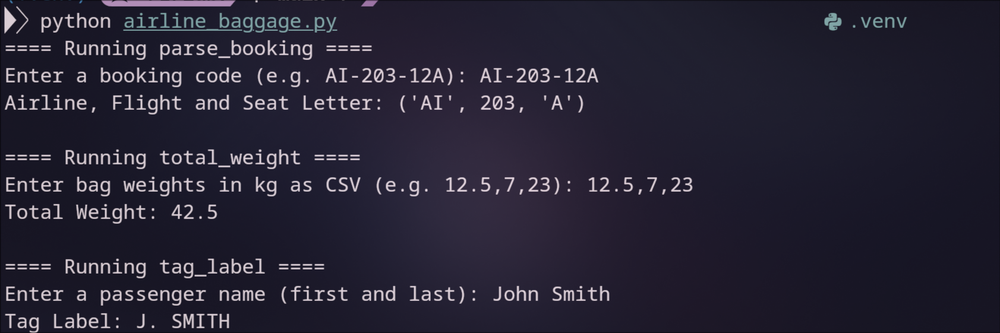

# LAB 7: Fuzzing for Input Validation Bugs
#### Name: Dharani S
#### SRN: PES2UG24CS157
#### Section: C
**Repository:** L6_L7_28 – Airline Baggage Fees

## 1. Objective

To identify input validation bugs in a Python application using Hypothesis fuzz testing and fix them using defensive programming.

## 2. Tools Used

- Python 3.14
- Hypothesis
- Pytest

## 3. Original Application Execution

Executed the original application using valid sample inputs.

- Booking code: `AI-203-12A`
- Baggage weights: `12.5,7,23`
- Passenger name: `John Smith`

## 4. Fuzz Testing – Initial Execution

Implemented Hypothesis tests using `st.text()` and `st.none()` to generate unexpected inputs for all three functions.

**Functions tested:**
- `parse_booking()`
- `total_weight()`
- `tag_label()`

**Result:** All three tests failed due to input validation errors.

## 5. Bug Fixes

Modified `airline_baggage.py` to handle invalid and unexpected inputs.

| Function | Fix |
|---|---|
| `parse_booking()` | Added booking code format and input validation. |
| `total_weight()` | Added numeric validation and checks for negative and non-finite weights. |
| `tag_label()` | Added input type and name component validation. |

Invalid inputs are handled by returning `None` instead of raising unhandled exceptions.

## 6. Fixed Application Execution

Executed the modified application using the same valid sample inputs.

## 7. Fuzz Testing – Final Execution

Re-executed the three Hypothesis tests after fixing the application.

**Result: 3 passed.**

Additional functional tests were included to verify valid and invalid inputs for all three functions.

**Final result: 9 passed.**

## 8. Deliverables

1. `airline_baggage.py` – Fixed application script.
2. `test_airline_baggage.py` – Updated Hypothesis test file.
3. `Lab7_Report.pdf` – Report containing execution screenshots.

## 9. Conclusion

Hypothesis fuzz testing identified input validation bugs in all three functions. Defensive validation was implemented, and all nine tests passed successfully.